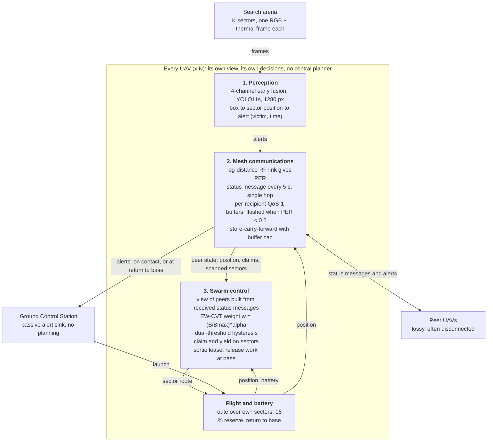

# Autonomous Multispectral UAV Swarm for Search and Rescue (SAR)

[](https://www.python.org/downloads/)
[](https://pytorch.org/)
[](https://github.com/ultralytics/ultralytics)
[](https://gradio.app/)

A simulation platform for multi-UAV search and rescue. It combines **4-channel early-fusion RGB + thermal victim detection**, a **delay-tolerant ad-hoc mesh** with RF propagation modelling, and **fully decentralized, energy-aware swarm control** (Energy-Weighted CVT partitioning, hysteresis, sector claiming and failover, with no central planner), with a live mission console and an ablation study that measures what each component contributes.

> **Start here:** [results](results/README.md) (ablation study, all numbers reproducible) · [architecture diagrams](docs/ARCHITECTURE_PROPOSAL.md) · [how to run](docs/HOW_TO_RUN.md)

---

## Table of Contents

- [System Architecture](#system-architecture)
- [Key Features](#key-features)
- [Results at a Glance](#results-at-a-glance)
- [Scope and Limitations](#scope-and-limitations)
- [Directory Layout](#directory-layout)
- [Installation & Setup](#installation--setup)
- [Quick Start](#quick-start)
- [Flight & Network Dynamics](#flight--network-dynamics)
- [Training & Dataset Pipeline](#training--dataset-pipeline)
- [SITL Autopilot & ns-3 Integration](#sitl-autopilot--ns-3-integration)
- [Citations & Credits](#citations--credits)

---

## System Architecture

Three contributions run on every UAV: perception, mesh communications, and swarm control. There is **no central planner**: each UAV plans from its own view of the swarm, built from beacons it has actually received over the lossy radio. The ground station only receives alerts.



More diagrams (per-UAV pipeline, control loop, hysteresis gate, alert delivery and the packet delivery algorithm, forwarding policies, state machine, failover, module map, evaluation design) are in [`docs/ARCHITECTURE_PROPOSAL.md`](docs/ARCHITECTURE_PROPOSAL.md).

---

## Key Features

1. **4-channel early-fusion perception.**
   - Visible RGB and thermal LWIR are stacked into one 4-plane tensor and fed to a YOLO network whose first convolution takes 4 channels. The shipped model (`best.pt`) is YOLO11s trained on the NII-CU RGB-thermal drone dataset; the detector also loads the earlier YOLOv8-P2 variant.
   - The thermal kernel is initialised from the pretrained red-channel kernel; training uses no colour jitter, since a thermal channel makes it meaningless.

2. **Decentralized Energy-Weighted CVT control.**
   - Each UAV gets a weight `w = (B / B_max)^α` from its battery. A sector goes to the UAV with the smallest weighted distance `‖c_s − g_i‖² / w_i`, so low-battery UAVs receive smaller territories. `α = 0` is plain Voronoi. The launch partition is a converged CVT from Lloyd iterations.
   - Every UAV runs this itself, every 5 s, over the peers *it believes* are active, using their last advertised generators and weights. UAVs claim sectors, yield to better claims when they meet, and idle UAVs pick up unclaimed work.

3. **Dual-threshold hysteresis.**
   - A UAV commits a new territory only if its battery has dropped by at least 2 % **and** its ideal centroid has moved at least 5 m. A change in its view of the live UAVs overrides both thresholds.
   - Where partitions are recomputed from noisy readings every tick (a test configuration, `--planner centralized`), this removes about 10× the partition commits and about 5× the sector flips. In the decentralized planner claims are sticky, so there is little churn for it to remove.

4. **Failure detection and failover without a coordinator.**
   - A UAV cannot hear a failure in flight, because the mesh is mostly disconnected. Instead each UAV advertises when its route should bring it home; a peer missing a lease-slack period past that is presumed lost and its claims are released.
   - Released work is taken only by UAVs at base, which hear landed peers and share it. A UAV that reaches the 15 % battery reserve aborts and returns to base; at 0 % it is lost.

5. **Delay-tolerant FANET mesh.**
   - Log-distance path loss with shadow fading maps distance to SNR and packet error rate. State beacons and victim alerts both travel this link. Failed alerts wait in per-recipient QoS-1 store-and-forward buffers and flush when the link recovers, which in practice is when the UAV is back at base. Any UAV that receives an alert also carries it onward (store-carry-forward) and hands it over whenever it later meets a recipient, so no UAV has to be in the right place at the right moment.
   - Every alert also goes to a **Ground Control Station**, so the simulator measures what the operator actually learns, and how late.

6. **Mission console and validation.**
   - A Gradio console (`demo.py`) streams a live tracking radar. A validator scores detections against ground truth (precision, recall, F1, localization error) and produces publication figures.

7. **Ablation study.**
   - Every component has an on/off switch. A harness runs 1,820 paired missions and a detector evaluation, and writes a report. See [`results/README.md`](results/README.md).

8. **Literature baselines inside the same simulator.**
   - *Alert forwarding* (`--gcs-policy`): our epidemic store-carry-forward is compared with Spray-and-Wait (`spray`, L = 3), PRoPHET (`prophet`), a GeoSaW-style single-copy forwarder (`geosaw`, an approximation using return time to base, not the original waypoint-based protocol) and carrying alerts home only (buffer only). A *copies per alert* metric measures the traffic cost.
   - *Task allocation* (`--allocation`): EW-CVT is compared with a nearest-bidder auction (`auction`, not a full CBBA), the same auction without failover, and a static partition.

---

## Results at a Glance

Each row removes one component and reports the change over 20 paired seeds, with a 95 % confidence interval. Full tables, charts, and the exact experimental setup are in [`results/README.md`](results/README.md).

| Component removed → measured effect | Full system | Ablated | Change (paired mean ± 95% CI) |
|---|---:|---:|---:|
| **Failover** (UAV lost): area coverage | 98.4 % | 87.4 % | -11.0 ± 2.6 pts |
| &nbsp;&nbsp;victims found, whole arena (recall) | 0.962 | 0.840 | -0.122 ± 0.032 |
| **Hysteresis** (per-tick re-planning test, σ = 2 %): sector flips / mission | 2.5 | 13.5 | +11.0 ± 3.5 |
| &nbsp;&nbsp;route changes / mission | 4.8 | 25.4 | +20.6 ± 6.4 |
| &nbsp;&nbsp;mission time | 362 s | 392 s | +30 ± 25 s |
| **EW weighting** (α=0): min final battery | 18.8 % | 17.9 % | -0.8 ± 0.7 pts |
| Static baseline vs full: mission time (cost of re-planning) | 364 s | 353 s | -11 ± 29 s |
| **Epidemic forwarding vs spray-and-wait** (3 km): mean alert latency | 41 s | 49 s | +8 ± 2 s |
| &nbsp;&nbsp;copies per alert (the price of epidemic) | 4.30 | 2.37 | -1.93 ± 0.20 |
| **EW-CVT vs nearest-bidder auction** (nominal): min final battery | 18.8 % | 17.4 % | -1.4 ± 1.1 pts |
| &nbsp;&nbsp;(UAV lost): mission time, EW-CVT is slower | 554 s | 481 s | -73 ± 58 s |
| **DTN buffer** (5 km): victims known to operator | 98.0 % | 3.4 % | -94.7 ± 1.2 pts |
| &nbsp;&nbsp;swarm-wide consensus | 100.0 % | 22.1 % | -77.9 ± 1.3 pts |
| **Forwarding** (5 km): mean alert latency | 103 s | 109 s | +7 ± 2 s |
| &nbsp;&nbsp;UAV lost at 60 s: reports known to operator | 100.0 % | 100.0 % | +0.0 ± 0.0 pts |
| **Thermal channel** (masked), day: AP50 | 99.8 | 0.0 | -99.8 |
| &nbsp;&nbsp;night: AP50 | 94.3 | 0.0 | -94.3 |

**Reference mission** (6 UAVs, 5 km × 5 km arena, 25 sectors, launch batteries 20–100 %, decentralized planner, no failure, mean ± standard deviation over 20 seeds):

| Metric | Value |
|---|---:|
| Area coverage | 100.0 ± 0.0 % |
| Precision | 0.980 ± 0.019 |
| Recall (whole arena) | 0.980 ± 0.015 |
| F1 | 0.980 ± 0.013 |
| Localization error, mean | 1.45 ± 0.15 m |
| Localization error, RMSE | 1.86 ± 0.32 m |
| Time to first detection | 8.6 ± 7.2 s |
| Mission time | 353 ± 31 s |
| Mean energy used per UAV | 13.7 ± 1.4 % of battery |
| Min final battery | 18.8 ± 8.3 % |
| Victims known to operator | 100.0 ± 0.0 % |

**Reading the results**
- **Delay-tolerant networking is the largest effect.** At these ranges the swarm is mostly out of direct radio contact, so without buffering almost no victim reaches the operator.
- **Failover protects coverage** when a UAV is lost.
- **Decentralization costs time after a failure.** After a loss the swarm cannot know until a UAV is overdue back at base, so failover takes minutes. Detection speed trades against false alarms through the lease slack (see [`results/README.md`](results/README.md#5-decentralized-control-failure-detection)).
- **Hysteresis removes churn, not flight time**, and only where partitions are recomputed from noisy readings (per-tick re-planning test).
- **EW-CVT is a trade-off, not a free gain.** Larger `α` raises the worst-case remaining battery but lengthens the mission; at `α = 1` the benefit is modest.
- **Store-carry-forward relaying shortens alert latency and protects alerts when the finder is lost**, because any UAV that received an alert carries it onward. It needs a large enough buffer: capping copies per UAV too low costs most of the benefit.
- **Against forwarding baselines, epidemic is fastest but keeps the most copies.** At 3 km it is 7.6 ± 1.7 s faster than Spray-and-Wait and 10.7 ± 3.2 s faster than PRoPHET, at 4.3 copies per alert versus 2.4 and 3.2. The cheaper policies trade latency for traffic.
- **Against nearest-bidder auction, energy-weighted partitioning is not clearly faster.** It leaves a higher minimum battery (+1.4 ± 1.1 points) and fewer duplicate scans (−1.15 ± 0.53), but after a UAV loss it is slower (+73 ± 58 s). The large coverage gain after a loss comes from the lease-based failover (98.4 % versus 89.2 % without it), not from the weighting.

---

## Scope and Limitations

- **Simulation, not flight.** Dynamics are kinematic: constant speeds and linear battery drain. The control, networking and detection logic is real code; the aircraft and the radio are models.
- **Decentralized planning has simplifications.** UAVs launch together on the pad, so they start with the same view and launch partition. Beacons are single-hop (no relaying of third-party state), and failure detection rests on a lease design with a tunable slack, which is one reasonable design rather than the only one. Victim alerts are still addressed to every peer whether or not it is alive.
- **Decentralization has a measured cost.** Failures are noticed only when a UAV is overdue back at base, so failover takes minutes and mission time after a loss is longer (see results). In a few seeds sectors stay unsearched because the survivors have no battery for a second sortie.
- **Detection inside missions replays static frames.** Each sector shows one dataset image, so mission-level precision and recall mainly reflect the detector on those frames plus which sectors were visited. Localization error measures the box-to-sector mapping, not geolocation.
- **The perception ablation is modality-masked inference** of one fused network, not separately trained RGB-only and thermal-only models. Train and validation frames come from the same site, so absolute numbers are optimistic.
- **Network results depend on the RF model** (see below). The 15 % abort rule and the battery-sensor noise levels are scenario assumptions.

---

## Directory Layout

```
FlyNetSim/
├── best.pt                             # Active 4-channel YOLO11s weights (default for every entry point)
├── requirements.txt                    # Python dependencies
├── demo.py                             # Interactive Gradio web console with live radar
├── simulate_swarm_mission.py           # Mission simulator: decentralized planning, hysteresis, failover,
│                                       #   mesh + DTN, per-component ablation switches
├── validate_swarm_mission.py           # Ground-truth validator & publication figure generator
├── sar_world.py                        # In-memory spatial world & ground-truth generator
├── rgbt_detector.py                    # 4-channel early-fusion YOLO detector (YOLO11 & YOLOv8-P2)
│
├── ablation/                           # Ablation study: perception_eval, run_ablation, make_report, make_readme
├── results/                            # Ablation results: README.md, HTML report, figures, raw run data
│
├── FlySim/                             # Control, networking and hardware-in-the-loop components
│   ├── hysteresis_controller.py        # Dual-threshold hysteresis controller & EW-CVT partitioning
│   ├── swarm_agent.py                  # Per-UAV decentralized agent: local view, claims, leases, failure suspicion
│   ├── swarm_network.py                # EdgeBroker, RF physics engine, QoS 1 buffers
│   ├── uav_pubsub.py                   # ArduPilot SITL / DroneKit flight control loop
│   ├── FlyNetSim.py                    # Original multi-UAV SITL launcher
│   └── tools/                          # SITL and network helper scripts
│
├── training/                           # Multispectral detector training pipeline (scripts, notebooks, configs)
├── tests/                              # Automated test suite (test_sar_system.py)
├── scripts/debug/                      # One-off model / dataloader checks (not part of the test suite)
├── models/legacy/                      # Earlier checkpoints (YOLOv8-P2, 4-class)
│
├── docs/                               # HOW_TO_RUN, metric specifications, architecture notes and diagrams
├── paper/                              # IEEE paper sources and figures
├── code_printout/                      # Printable code listings
└── NetSim/                             # ns-3 network simulation integration
```

Mission outputs (`metrics_*.csv`, `swarm_mission_output.json`, `mission_validation_report.json`,
`ground_truth_world.json` and the two validation PNGs) are written to the repository root when you run the
simulator and validator. They are git-ignored.

---

## Installation & Setup

### Prerequisites
- Linux (Ubuntu 20.04 / 22.04 LTS recommended)
- Python 3.10+
- The NII-CU 4-channel dataset for real frames (the simulator falls back to blank synthetic frames without it, which produces no detections)

### Setup Virtual Environment
```bash
python3 -m venv venv
source venv/bin/activate
pip install -r requirements.txt
```

The default dataset location is set in `sar_world.py` (`~/Downloads/NII_CU_MAPD_4CH/images/val`); pass `images_dir` / `labels_dir` to `SARWorld` to change it.

---

## Quick Start

### 1. Launch Interactive Web Console
```bash
python demo.py
```
Open **`http://localhost:7860`** in a web browser.

- **Mission Map**: validation map, flight tracks, base station and located victim coordinates.
- **Camera Feed**: multispectral frame with view toggles (composite colour and thermal, visible RGB, thermal LWIR).
- **Network Status**: transmission activity and communication distance vs. SNR / PER curves.
- **Run Mission**: choose swarm size (2–12 UAVs), arena size (400–5000 m) and failure parameters, then watch the live tracking radar.

### 2. Run a Swarm Mission from the CLI
```bash
# 6 UAVs, 5 km x 5 km arena, launch batteries 20-100 %, UAV 2 fails at t = 80 s (decentralized planner)
python simulate_swarm_mission.py --drones 6 --arena 5000 --duration 900 \
    --batt-min 20 --batt-noise 1.5 --fail-drone 2 --fail-time 80
```
A 5 km mission takes roughly 350-450 simulated seconds, so use `--duration 900`; the default of 180 s ends it early.

| Option | Meaning (default) |
|---|---|
| `--drones` | Swarm size (3) |
| `--arena` | Arena width and height in metres (400) |
| `--grid` | Sector grid dimension, N × N (5) |
| `--conf` | Detection confidence threshold (0.20) |
| `--duration` | Maximum mission time in seconds (180) |
| `--seed` | Random seed (42) |
| `--model` | Detector weights (`best.pt`) |
| `--alpha` | EW-CVT exponent; `0` is plain Voronoi (1.0) |
| `--fail-drone`, `--fail-time` | Inject a motor failure on this UAV at this time |
| `--batt-min` | UAVs start with battery uniform in [min, 100] % (100) |
| `--batt-noise` | Battery-measurement noise, std-dev in % points (0) |
| `--planner` | `decentralized` (per-UAV views, default) or `centralized` (test only: re-plans from true state every tick) |
| `--gcs-policy` | Alert forwarding baseline: `spray`, `prophet` or `geosaw` (default: epidemic store-carry-forward) |
| `--spray-copies` | Copies per alert for `spray` (3) |
| `--allocation` | `ewcvt` (default) or `auction` (nearest-bidder baseline) |
| `--beacon-interval` | Seconds between state beacons (5) |
| `--lease-slack` | Seconds a peer may be overdue back at base before it is presumed lost (60) |
| `--buffer-cap` | Max buffered alert copies per UAV (unlimited) |
| `--out-dir` | Where logs and JSON are written (`.`) |

**Ablation switches** (each removes one component): `--no-hysteresis`, `--no-failover`, `--static` (no dynamic re-planning), `--no-dtn` (no store-and-forward), `--no-forwarding` (UAVs do not carry others' alerts onward).

### 3. Validate a Mission and Generate Figures
```bash
python validate_swarm_mission.py
```
Writes `mission_validation_report.json` (summary and matched detections), `sar_mission_spatial_validation.png` and `sar_network_and_mission_performance.png` (300 DPI).

### 4. Run the Test Suite
```bash
python -m unittest discover -s tests
```
26 tests cover spatial world geometry, 4-channel tensor handling, RF physics, the hysteresis controller, EW-CVT allocation, the decentralized claiming agent (leases, yielding, work released only at base), store-carry-forward forwarding and buffer caps, and the streaming simulator with failover. Tests write to temporary directories and do not touch mission outputs.

### 5. Reproduce the Ablation Study
```bash
python ablation/perception_eval.py --n 150     # detector evaluation (~20 min on CPU)
python ablation/run_ablation.py --seeds 20     # 1,820 missions
python ablation/make_report.py                 # HTML report + figures
python ablation/make_readme.py                 # results/README.md
```

---

## Flight & Network Dynamics

### Flight envelope and battery
Transit and return run at up to 50 m/s; search cruise at up to 32 m/s.

$$\mathbf{v}(t) = \begin{cases} 50.0\text{ m/s} & \text{state} \in \{\text{TRANSIT, RETURNING}\} \\ 32.0\text{ m/s} & \text{state} = \text{SEARCHING} \\ 0.0\text{ m/s} & \text{state} \in \{\text{LANDED, CRASHED}\} \end{cases}$$

Battery drains at 0.07 %/s above 40 m/s and 0.04 %/s otherwise. A UAV at or below the 15 % reserve aborts and returns to base; at 0 % it is lost.

Each UAV visits its sectors in a nearest-neighbour tour (a greedy heuristic, not an optimal route) and returns to its launch pad.

### EW-CVT and the dual-threshold hysteresis gate
Weights and territory centres are committed only when the gate opens, so battery noise does not move partition borders.

1. **Battery threshold** ($\tau_\epsilon = 0.02 \times B_{\text{max}}$):
   $$w_i(t) = \begin{cases} \left(\frac{B_i(t)}{B_{\text{max}}}\right)^\alpha, & \text{if } B_i(t_k) - B_i(t) \ge \tau_\epsilon \\ w_i(t_k), & \text{otherwise} \end{cases}$$
   with $\alpha$ (`--alpha`, default `1.0`) setting energy sensitivity: $\alpha = 0$ is plain Voronoi, $\alpha = 1$ makes territory scale roughly with remaining battery, and $\alpha \ge 2$ contracts low-battery territories aggressively.

2. **Spatial threshold** ($\tau_\delta = 5.0$ m):
   $$C_i(t) = \begin{cases} C_i^*, & \text{if } \|C_i^* - C_i(t_k)\| \ge \tau_\delta \\ C_i(t_k), & \text{otherwise} \end{cases}$$

3. **Topology override:**
   $$\mathcal{U}_i(t) = \left( (B_i(t_k) - B_i(t) \ge \tau_\epsilon) \land (\|C_i^* - C_i(t_k)\| \ge \tau_\delta) \right) \lor (\mathcal{N}(t) \ne \mathcal{N}(t_k))$$
   A change in the set of live UAVs $\mathcal{N}(t)$ commits immediately, regardless of the thresholds. Unscanned sectors are then assigned by weighted distance:
   $$\text{Cost}(s, i) = \frac{\|\mathbf{c}_s - \mathbf{g}_i\|^2}{(B_i / B_{\text{max}})^\alpha}$$

### RF channel and delay-tolerant delivery
Path loss, shadow fading and obstruction give the received SNR, which maps to a packet error rate:

$$PL(d) = PL(d_0) + 10\,n\,\log_{10}\!\frac{d}{d_0} + X_\sigma \;[+\,15\text{ dB if obstructed}], \qquad PL(d_0) = 20\log_{10} f_{\text{MHz}} - 27.55$$

$$\text{SNR} = P_{tx} - PL(d) - N_0, \qquad \text{PER} = \begin{cases} 0 & \text{SNR} > 25\text{ dB} \\ 1 - \left(1 + e^{-0.5(\text{SNR}-15)}\right)^{-1} & 5 \le \text{SNR} \le 25 \\ 1 & \text{SNR} < 5\text{ dB} \end{cases}$$

| Parameter | Value |
|---|---|
| Path-loss exponent $n$, reference distance $d_0$ | 2.5, 1 m |
| Shadow fading $\sigma$ | 4 dB (log-normal) |
| Obstruction | 15 dB penalty; modelled as a random 10 % chance beyond 50 m |
| Noise floor $N_0$ | −90 dBm |
| Arenas ≥ 2 km | 33 dBm at 2.4 GHz, direct link reaches PER ≈ 0.5 at about 520 m |
| Smaller arenas | 30 dBm at 5 GHz, direct link reaches PER ≈ 0.5 at about 220 m |

Because direct range is a few hundred metres against arenas of several kilometres, the swarm is mostly disconnected in flight. A failed alert waits in a per-recipient QoS-1 FIFO buffer on the sending UAV and is flushed when the packet error rate to that recipient falls below 0.2, which in practice happens when the UAV returns to base. The ablation measures the effect on what the operator learns and how late; see [`results/README.md`](results/README.md).

---

## Training & Dataset Pipeline

The shipped model (`best.pt`) is a 4-channel YOLO11s trained with [`training/train_yolo11_rgbt.ipynb`](training/train_yolo11_rgbt.ipynb) on the NII-CU RGB-thermal dataset (a GPU environment such as Kaggle is expected). The notebook builds the 4-plane inputs, checks the boxes, and trains with the thermal kernel seeded from the red-channel kernel. Separately trained RGB-only and thermal-only baselines have not been run; the perception ablation in the results masks one modality of this single fused network instead.

The earlier **YOLOv8n-P2** pipeline (stride-4 detection head for small targets) is kept for reference:

```bash
python training/prepare_dataset.py --src <RGBTDronePerson dir> --dst <output dir>
python training/train.py --data training/dataset_1cls_4ch.yaml \
    --model training/yolov8n-p2-1cls-4ch.yaml --epochs 40 --batch 32
```

Details are in [`training/README.md`](training/README.md). Note that `training/dataset_1cls_4ch.yaml` points at a local copy that contains only the validation split, so it is suitable for evaluation, not for a clean train/validation split.

---

## SITL Autopilot & ns-3 Integration

The repository also supports hardware-in-the-loop simulation via ArduPilot SITL and ns-3. This path is separate from the Python mission simulator used for the results above.

- **Flight initialization**: `FlySim/fly_init.sh` configures ArduPilot and DroneKit.
- **Network initialization**: `NetSim/net_init.sh` builds ns-3.27 with custom UAV communication patches.
- **Unified SITL launcher**: `python FlySim/FlyNetSim.py` launches concurrent SITL quadcopters alongside ns-3 ad-hoc routing.

---

## Citations & Credits

The underlying network-flight synchronization infrastructure builds upon the FlyNetSim architecture:

```bibtex
@inproceedings{baidya2018flynetsim,
    title={FlyNetSim: An Open Source Synchronized UAV Network Simulator based on ns-3 and Ardupilot},
    author={Baidya, Sabur and Shaikh, Zoheb and Levorato, Marco},
    booktitle={Proceedings of the 21st ACM International Conference on Modeling, Analysis and Simulation of Wireless and Mobile Systems (ACM MSWiM)},
    pages={37--45},
    year={2018},
    organization={ACM}
}
```

The multispectral early-fusion detector, delay-tolerant store-and-forward mesh, energy-weighted swarm control, base-station launch dynamics, failover, mission console and ablation study were developed as part of this Search and Rescue extension.
