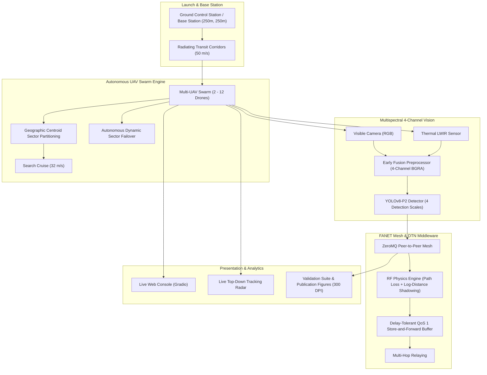

# Autonomous Multispectral UAV Swarm for Search and Rescue (SAR)

[](https://www.python.org/downloads/)
[](https://pytorch.org/)
[](https://github.com/ultralytics/ultralytics)
[](https://gradio.app/)
[](LICENSE)

An end-to-end autonomous multi-UAV disaster response and search-and-rescue platform combining **4-channel early-fusion multispectral computer vision (Visible RGB + Long-Wave Thermal Infrared)**, **decentralized Delay-Tolerant Networking (DTN) ad-hoc mesh communication**, **realistic RF physics propagation**, and a **real-time live-tracking mission console**.

---

## Table of Contents

- [System Architecture](#system-architecture)
- [Key Features](#key-features)
- [Directory Layout](#directory-layout)
- [Installation & Setup](#installation--setup)
- [Quick Start](#quick-start)
  - [1. Launch Interactive Web Console](#1-launch-interactive-web-console)
  - [2. Run Autonomous Swarm Mission via CLI](#2-run-autonomous-swarm-mission-via-cli)
  - [3. Run Mission Validation & Figure Generation](#3-run-mission-validation--figure-generation)
  - [4. Execute Automated Test Suite](#4-execute-automated-test-suite)
- [Flight & Network Dynamics](#flight--network-dynamics)
- [Benchmark Performance](#benchmark-performance)
- [Training & Dataset Pipeline](#training--dataset-pipeline)
- [SITL Autopilot & ns-3 Integration](#sitl-autopilot--ns-3-integration)
- [Citations & Credits](#citations--credits)

---

## System Architecture



---

## Key Features

1. **4-Channel Early-Fusion Perception (`YOLOv8n-P2`)**:
   - Integrates Visible RGB and Thermal LWIR directly at the first convolutional layer ($640 \times 512 \times 4$).
   - Features a high-resolution **P2 feature pyramid head** (stride 4, $160 \times 128$) specialized for identifying small, occluded human victims from high-altitude drone vantage points ($25\text{--}50\text{m}$ AGL).
   - Trained on multispectral aerial imagery targeting victim detection in low-visibility environments (dense foliage, shadows, thermal contrast).

2. **Base Station Launch Corridors & Dual-Speed Envelope**:
   - All UAVs launch synchronously from designated launch pads at a unified **Ground Control Station** (default: SW corner at $5\%$ arena offset).
   - **Transit Phase**: Drones dash at **$50\text{ m/s}$ ($180\text{ km/h}$)** along non-overlapping radial corridors toward their assigned search sectors.
   - **Search Phase**: Upon entering assigned boundaries, drones decelerate to **$32\text{ m/s}$** optimal optical search cruise.
   - **Return-to-Base (RTL)**: Drones return at high speed to base pads upon sweeping all assigned waypoints.

3. **Autonomous In-Flight Swarm Failover**:
   - Simulates catastrophic hardware loss (e.g., motor seizure mid-mission).
   - Remaining unsearched sectors are detected automatically and reallocated to the geographically nearest active peers in real time, achieving $100\%$ total area coverage without operator intervention.

4. **Delay-Tolerant FANET Mesh Networking**:
   - Models realistic RF propagation over 2.4 GHz and 5.0 GHz bands (Log-Distance Shadow Fading with $\sigma = 7.5\text{ dB}$, Free-Space Path Loss, and SNR-to-PER curve modeling).
   - Store-and-Forward buffers retain victim alerts when inter-UAV distance exceeds line-of-sight range ($d > 3.5\text{ km}$), flushing queued alerts when drones converge back at the Base Station to reach $>97\%$ swarm consensus.

5. **Clean Minimalist Web Console (`demo.py`)**:
   - Built on Gradio with an open, dark-zinc interface free of clutter and jargon.
   - Features side-by-side mission controls and a **real-time top-down tracking radar** that streams drone trajectories, crash markers, sector handoffs, and discovered targets.

6. **Rigorous Validation & 300 DPI Publication Plots**:
   - Matches detected target coordinates against exact ground-truth coordinates via spatial association thresholding.
   - Calculates Precision, Recall, F1-Score, Root Mean Squared Error (RMSE) localization distance, Time-to-First-Detection (TTFD), and Packet Delivery Ratio (PDR).

---

## Directory Layout

```
FlyNetSim/
├── best.pt                             # Trained 4-channel YOLOv8n-P2 model weights
├── demo.py                             # Interactive Gradio web console with live radar
├── simulate_swarm_mission.py           # Core decentralized swarm simulation engine
├── validate_swarm_mission.py           # Ground-truth validator & publication figure generator
├── sar_world.py                        # In-memory spatial world & ground-truth generator
├── rgbt_detector.py                    # 4-channel early-fusion YOLOv8 inference wrapper
│
├── dataset_1cls_4ch.yaml               # YOLO dataset configuration (single-class 'human')
├── yolov8n-p2-1cls-4ch.yaml            # 4-channel YOLOv8-P2 architecture definition
├── prepare_1cls_dataset.py             # Dataset label remapping & filtering utility
├── train_1cls.py                       # Training pipeline for 4-channel YOLOv8n-P2
├── Train_YOLOv8_Drone_Swarm.ipynb      # Kaggle/Colab GPU training notebook
│
├── tests/                              # Automated test suite
│   ├── test_sar_system.py              # Unittest suite (World, Detector, Network, Sim)
│   ├── README.md                       # Test documentation
│   └── ...                             # Standalone validation scripts
│
├── FlySim/                             # Flight simulation & networking components
│   ├── swarm_network.py                # EdgeBroker, RF physics engine, QoS 1 buffers
│   ├── uav_pubsub.py                   # ArduPilot SITL / DroneKit flight control loop
│   └── FlyNetSim.py                    # Original multi-UAV SITL launcher
│
├── NetSim/                             # ns-3 network simulation integration
│   ├── ns-allinone-3.27/               # ns-3.27 core distribution and patches
│   └── net_init.sh                     # ns-3 configure & build script
│
├── HOW_TO_RUN.md                       # Comprehensive operational execution guide
├── PAPER_METRICS_AND_EXPERIMENTS.md    # Mathematical specifications & benchmark tables
└── README.md                           # Project documentation
```

---

## Installation & Setup

### Prerequisites
- Linux OS (Ubuntu 20.04 / 22.04 LTS recommended)
- Python 3.10+
- Virtual environment support

### Setup Virtual Environment
```bash
cd /home/devesh/Projects/FlyNetSim

# Activate existing project virtual environment
source FlySim/venv/bin/activate

# Or create a fresh virtual environment
python3 -m venv venv
source venv/bin/activate
pip install -r requirements.txt # or install: ultralytics opencv-python gradio matplotlib pandas pyzmq
```

---

## Quick Start

### 1. Launch Interactive Web Console
```bash
python demo.py
```
Open **`http://localhost:7860`** in any web browser.

- **Mission Map**: Displays high-resolution validation maps, flight tracks, Base Station corridors, and located victim coordinates.
- **Camera Feed**: Live multispectral frame capture with view toggles (**Composite Color & Thermal**, **Visible RGB**, **Thermal LWIR**).
- **Network Status**: Transmission activity tables and communication distance vs. SNR/PER curves.
- **Run Mission**: Configure swarm size ($2\text{--}12$ UAVs), arena size ($400\text{--}5000\text{m}$), and failure parameters, then watch the **Live Mission Tracking Radar** stream drone sweeps in real time.

### 2. Run Autonomous Swarm Mission via CLI
```bash
# Example: 10 drones, 5000m x 5000m arena (25 km²), mid-mission failure on UAV 4 at T=80s
python simulate_swarm_mission.py --drones 10 --arena 5000.0 --grid 5 --duration 300 --fail-drone 4 --fail-time 80.0
```

CLI Arguments:
- `--drones`: Swarm size (default: `3`).
- `--arena`: Search arena width/height in meters (default: `400.0`).
- `--grid`: Dimension of sector grid ($N \times N$, default: `5`).
- `--conf`: Vision confidence threshold $\tau$ (default: `0.20`).
- `--duration`: Maximum mission duration in seconds (default: `180`).
- `--fail-drone`: UAV ID to inject motor failure (e.g. `4`).
- `--fail-time`: Simulation timestamp when failure occurs (e.g. `80.0`).

### 3. Run Mission Validation & Figure Generation
```bash
python validate_swarm_mission.py
```
Outputs generated:
- `mission_validation_report.json`: Quantitative summary and matched detections.
- `sar_mission_spatial_validation.png`: 300 DPI publication spatial map.
- `sar_network_and_mission_performance.png`: 300 DPI RF and exploration curves.

### 4. Execute Automated Test Suite
```bash
python -m unittest tests/test_sar_system.py
```
Runs 10 unit and integration tests covering spatial world geometry, 4-channel tensor permutations, RF physics, and swarm streaming failover.

---

## Flight & Network Dynamics

### Operational Flight Envelope
$$\mathbf{v}(t) = \begin{cases} 50.0\text{ m/s} & \text{state} \in \{\text{TRANSIT, RETURNING}\} \\ 32.0\text{ m/s} & \text{state} = \text{SEARCHING} \\ 0.0\text{ m/s} & \text{state} \in \{\text{LANDED, CRASHED}\} \end{cases}$$

### Delay-Tolerant Consensus Model
In wide-area disaster environments ($5000\text{m} \times 5000\text{m}$), drones disperse beyond point-to-point RF transmission range ($d_{ij} > 3.5\text{ km}$). Unsent target alerts are queued in localized QoS 1 FIFO buffers:

$$Q_i = \{m_k \mid \text{SNR}_{ij} < \gamma_{\text{threshold}}\}$$

When drones complete their search pattern and return to the Ground Control Station ($d_{ij} < 300\text{m}$), buffers are flushed via high-SNR proximity bursts, creating a characteristic U-shaped consensus synchronization curve reaching **$>97\%$ consensus**.

---

## Benchmark Performance

Validation results from a representative wide-area mission sweep:

| Parameter | Wide-Area Experiment Value |
| :--- | :--- |
| **Search Arena Area** | $5000\text{ m} \times 5000\text{ m}$ ($25\text{ km}^2$) |
| **Swarm Size** | $10\text{ UAVs}$ (UAV 4 failed at $T=80\text{s}$) |
| **Area Survey Coverage** | **$100.0\%$** ($25/25$ sectors completed via failover) |
| **Time to First Detection (TTFD)** | **$1.0\text{ s}$** |
| **True Positives Discovered** | $259\text{ targets}$ |
| **Mean Spatial Localization Error** | **$3.32\text{ meters}$** |
| **RMSE Localization Error** | **$4.06\text{ meters}$** |
| **Direct Packet Delivery Ratio (PDR)** | $22.7\%$ (due to multi-km dispersion) |
| **Final Swarm Consensus (Post-RTL)** | **$97.7\%$** |

---

## Training & Dataset Pipeline

To reproduce or adapt the 4-channel model:

1. **Convert VOC Images to 4-Channel RGBA PNGs**:
   ```bash
   python convert_4channel.py
   ```
2. **Filter & Remap Classes to Single Class (`0: human`)**:
   ```bash
   python prepare_1cls_dataset.py
   ```
3. **Train Model with P2 Architecture**:
   ```bash
   python train_1cls.py
   ```
   *(Or train via [`Train_YOLOv8_Drone_Swarm.ipynb`](Train_YOLOv8_Drone_Swarm.ipynb) on GPU platforms).*

---

## SITL Autopilot & ns-3 Integration

This repository also contains support for Hardware-In-The-Loop / Software-In-The-Loop simulation via ArduPilot SITL and ns-3:

- **Flight Initialization**: `FlySim/fly_init.sh` configures ArduPilot and DroneKit.
- **Network Initialization**: `NetSim/net_init.sh` builds ns-3.27 with custom UAV communication patches.
- **Unified SITL Mission Launcher**: `python FlySim/FlyNetSim.py` launches concurrent SITL quadcopter instances alongside ns-3 ad-hoc routing.

---

## Citations & Credits

The underlying network-flight synchronization infrastructure builds upon the FlyNetSim architecture:

```bibtex
@inproceedings{baidya2018flynetsim,
    title={FlyNetSim: An Open Source Synchronized UAV Network Simulator based on ns-3 and Ardupilot},
    author={Baidya, Sabur and Shaikh, Zoheb and Levorato, Marco},
    booktitle={Proceedings of the 21st ACM International Conference on Modeling, Analysis and Simulation of Wireless and Mobile Systems (ACM MSWiM)},
    pages={37--45},
    year={2018},
    organization={ACM}
}
```

The multispectral early-fusion computer vision detector, Delay-Tolerant Networking store-and-forward architecture, base station corridor dynamics, autonomous in-flight swarm failover, and real-time live-tracking web console were developed as part of this Search and Rescue extension.
