# System Architecture: Diagram Proposal

Proposed set of architecture diagrams for the UAV-swarm SAR system. Each one answers a single question a
reviewer is likely to ask, and each is drawn from the **current code** (not from the earlier paper figure).
The diagrams are Mermaid so they render on GitHub; once the set is agreed they can be redrawn in TikZ for the paper.

| # | Diagram | The question it answers | Priority |
|---|---|---|---|
| D1 | System overview | What are the parts and how do they relate? | **Core** (one-slide architecture) |
| D2 | Per-UAV pipeline | What runs on each aircraft, from pixels to alert? | **Core** |
| D3 | Swarm control loop | How does EW-CVT + hysteresis decide who searches where? | **Core** |
| D4 | Hysteresis gate | When exactly does the controller change its mind? | Supporting |
| D5 | Alert dissemination and DTN | How does a victim alert reach the operator when links are down? | **Core** |
| D5b | Packet delivery algorithm | What exactly happens to one alert packet, step by step? | **Core** |
| D5c | Forwarding policies compared | How do epidemic, spray-and-wait and buffer-only differ? | Supporting |
| D6 | UAV state machine | What states can a UAV be in and what moves it between them? | Supporting |
| D7 | Failure and failover | What happens when a UAV is lost or runs low on battery? | Supporting |
| D8 | Software module map | Where does each idea live in the code? | Appendix |
| D9 | Evaluation architecture | How do the ablation switches map to the measured results? | **Core** (bridges to results) |

Suggested presentation order: D1 → D2 → D3 (with D4 as a zoom) → D5 → D9, with D6, D7 and D8 as backup slides.

---

## D1. System overview

Three contributions sit inside every UAV; the mission layer and the operator sit around them.

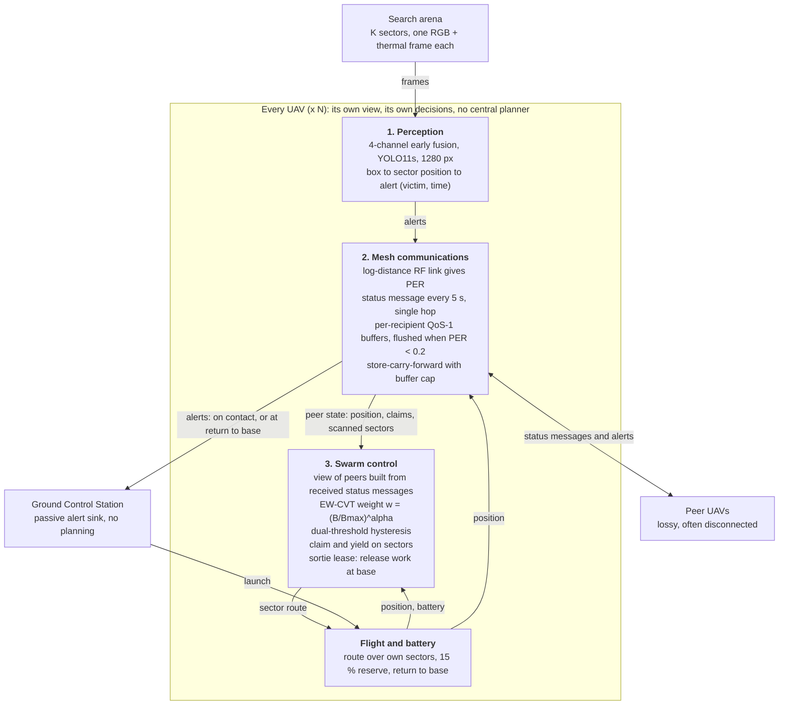

**Say:** each UAV carries a perception stack, a comms stack and a control stack. They interact through
three narrow interfaces: alerts (perception to comms), a sector route (control to flight), and peer beacons (comms to control). There is no central planner: control works only from the beacons this UAV has actually received.

---

## D2. Per-UAV pipeline

From sensor to operator, on one aircraft.

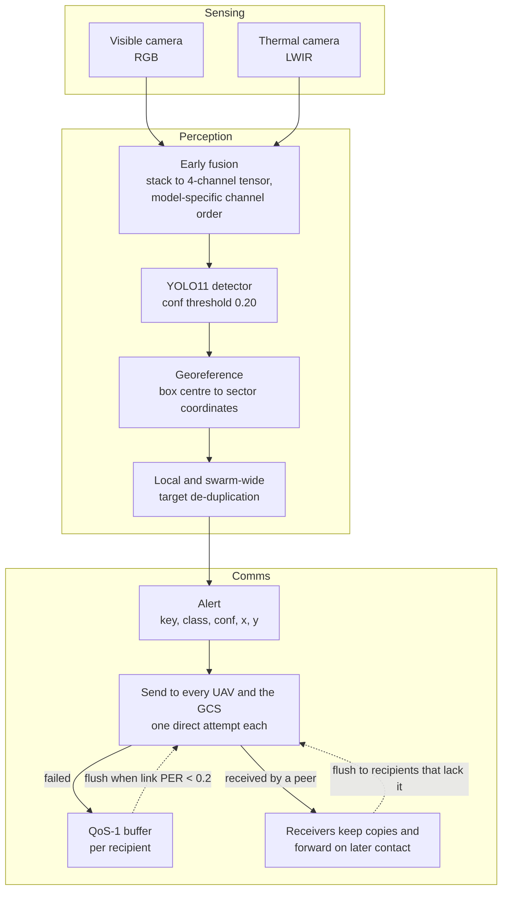

**Notes for accuracy:** georeferencing is a linear map from the box centre in the frame to the sector's bounds
(each sector is represented by one frame); it is **not** a pinhole camera model.

---

## D3. Swarm control loop (EW-CVT + hysteresis + claims), per UAV

Runs on **every UAV** every 5 s of mission time, from that UAV's own view only. There is no central planner. The hysteresis gate decides whether the UAV's territory parameters change.

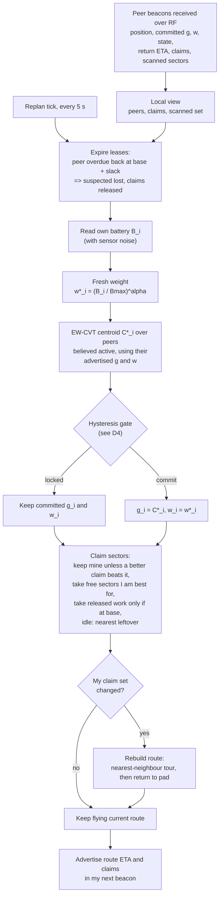

**Say:** alpha = 0 gives ordinary Voronoi; larger alpha shrinks low-battery UAVs' territories.
Because claiming uses only *committed* values, a locked gate means few ownership flips and little re-routing.
A test-only mode (`--planner centralized`) recomputes the partition from true state at every tick; it is used only for the hysteresis experiment.

---

## D4. Hysteresis gate

The dual-threshold rule with the topology override.

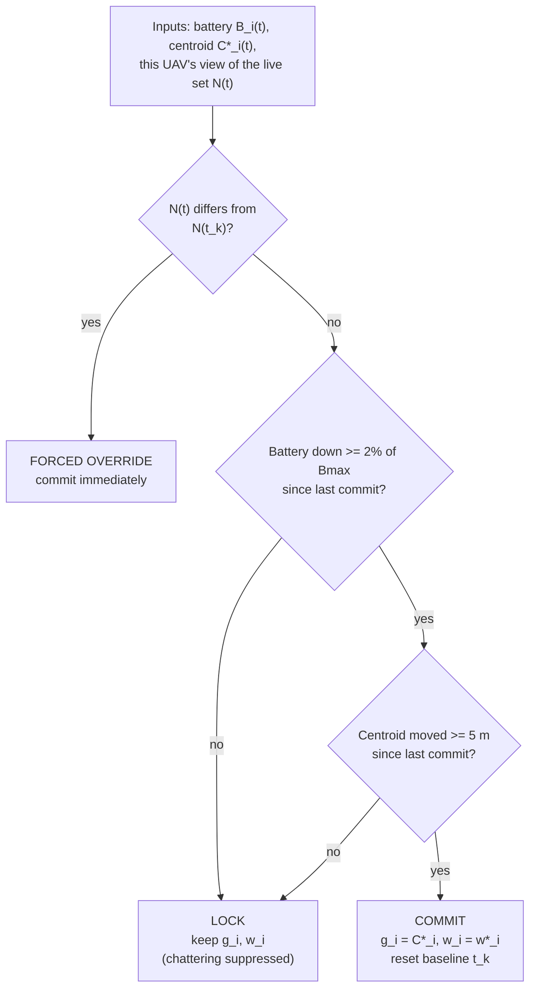

---

## D5. Alert dissemination and delay-tolerant delivery

Why the operator still learns about victims when the swarm is mostly out of radio range.

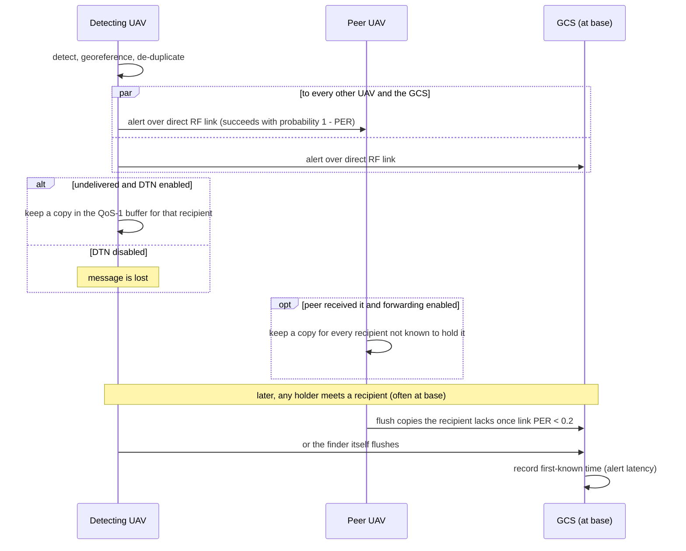

Because any UAV that received the alert carries it onward, the alert survives the finder being lost.

**RF model behind PER:** log-distance path loss (exponent 2.5), 4 dB shadow fading, 15 dB obstruction penalty,
SNR mapped to PER over 5 to 25 dB; 33 dBm at 2.4 GHz for arenas of 2 km or more, otherwise 30 dBm at 5 GHz.

---

## D5b. Packet delivery algorithm (what happens to one alert)

Decision flow for a single victim alert, as implemented in `simulate_swarm_mission.py`
(`_broadcast_alert`, `_try_deliver`, `_queue_copy`, `_receive_alert`, `_flush_buffers`).

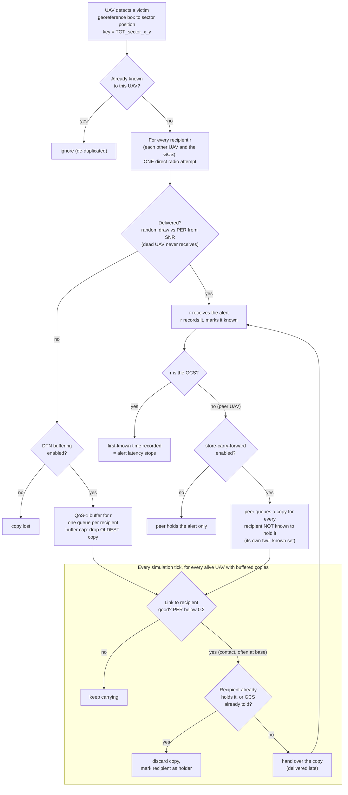

Key properties:
- **Direct first, then carry.** There is no routing table. The only network operation is a point-to-point attempt; everything indirect is *store-carry-forward*.
- **Per-recipient buffers** mean a copy for the GCS and a copy for each peer are tracked and flushed independently.
- **Contact-triggered:** a hand-over happens only when the link to the recipient is good (PER below 0.2), which for the GCS in a large arena usually means when a holder returns to base.
- **Only the missing copies are sent** (`fwd_known` and the recipient's own holdings are checked), so a pair of UAVs that meet exchange only what the other lacks.
- **Survives the finder's loss:** any UAV that received the alert is itself a carrier.

---

## D5c. Forwarding policies compared

The baselines replace *only* the GCS-bound relaying step; detection, direct attempts and buffers are identical.
Contacts are UAV pairs with PER below 0.2. Each policy answers one question when carrier **x** meets peer **y**
that does not hold alert `k`: *should x give y a copy?*

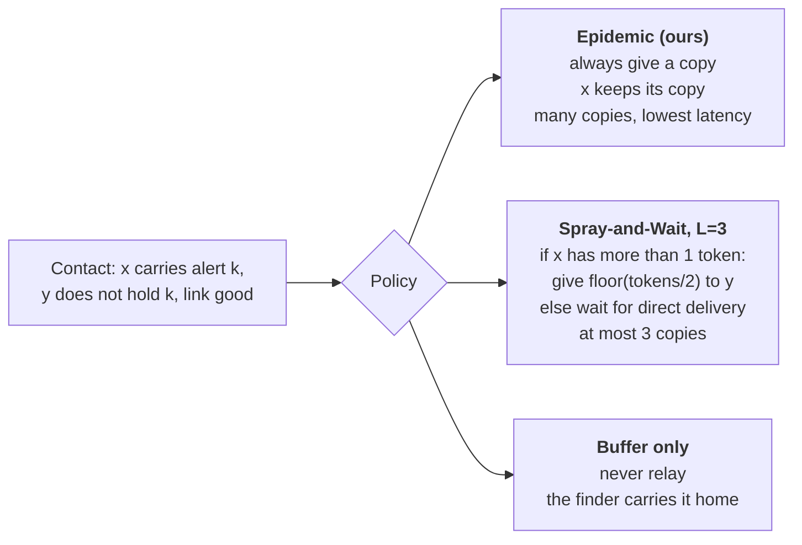

| Policy | Copies after a hand-over | Needs | Traffic cost |
|---|---|---|---|
| Epidemic (ours) | x and y both hold | nothing | highest |
| Spray-and-Wait | tokens split between x and y | copy budget L | at most L |
| Buffer only | only the finder holds | nothing | one copy |

---

## D6. UAV state machine

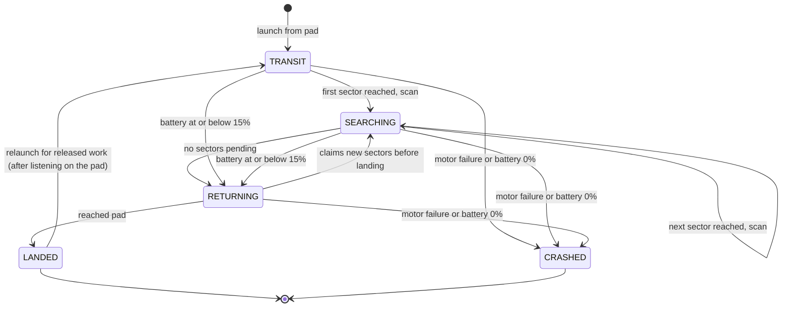

Speeds: transit and return up to 50 m/s; search cruise up to 32 m/s. Battery drains faster in transit than in search.

---

## D7. Failure and failover

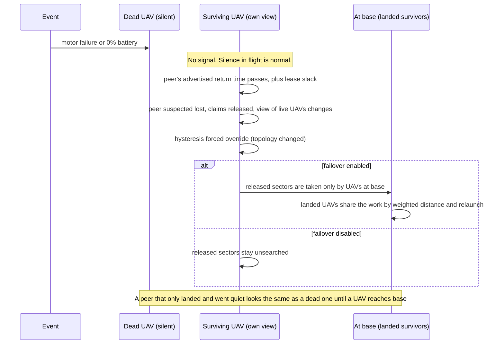

---

## D8. Software module map

Where each idea lives. The ArduPilot / ns-3 path is a separate, hardware-in-the-loop route and does not run in the Python mission simulator.

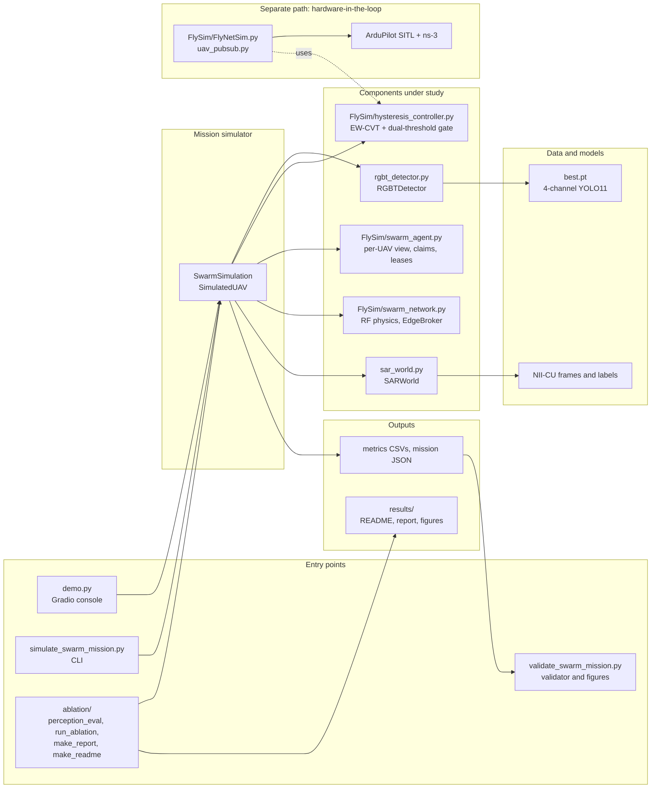

---

## D9. Evaluation architecture

How each switch removes one component and which measurements change. This links the architecture to the results.

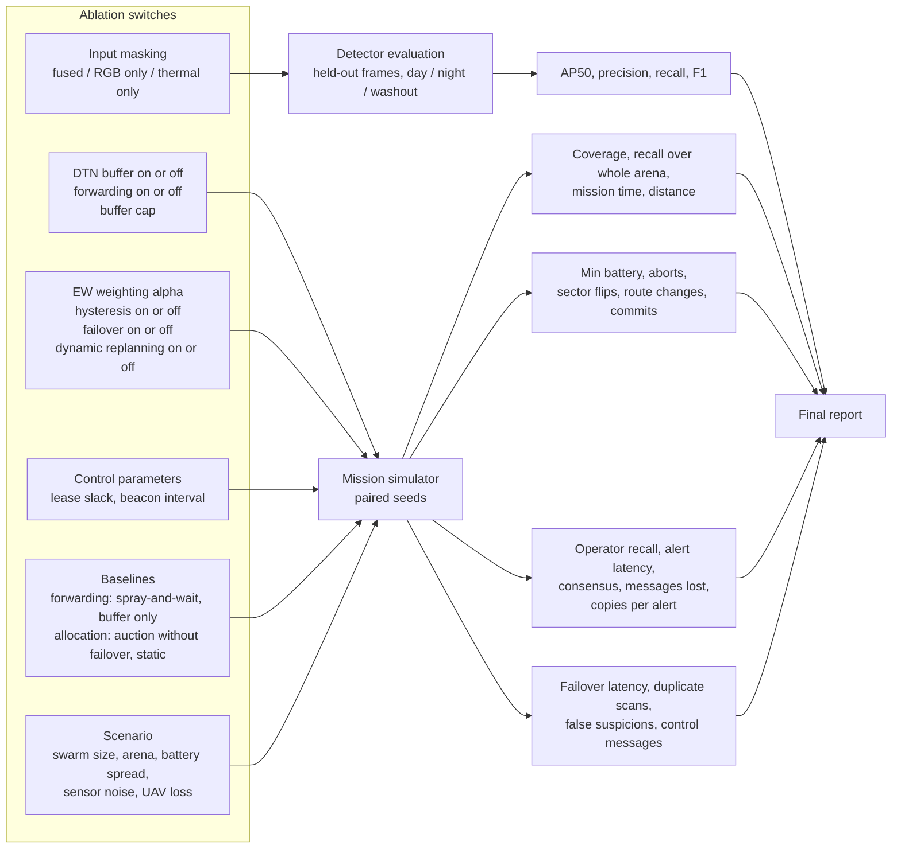

---

## Decisions needed before drawing

1. **Scope of "the system":** present only the Python mission simulator (what the results measure), or also the ArduPilot/ns-3 SITL path as a deployment route? Proposal: simulator in D1 to D7, SITL only in D8.
2. **Format:** keep Mermaid for GitHub and rebuild D1, D3 and D5 in TikZ for the paper, or produce one set only?
3. **Detail level for the professor:** D1 on its own may be enough for the main slide, with D3 and D5 as the two "how it works" slides. Say if you want fewer or more.
4. **Numbers on the diagrams:** which thresholds to show (2 %, 5 m, 5 s replan, 15 % reserve, RF parameters)? Proposal: show them only on D3, D4 and D5.
