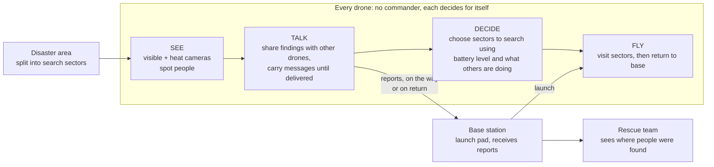

# Project Overview

## The problem

After a disaster such as a flood, an earthquake or a lost hiker, the first hours decide who is found alive. Searching a large area on foot or with a single helicopter is slow, and the people searching cannot see everything.

## The idea

Send out a **swarm of small drones** that search the area together, find people on their own, and tell the rescuers where they are.

Three things have to work for that to be useful, and this project builds all three:

1. **The drones must be able to spot people.** Each drone carries two cameras, an ordinary one and a heat-sensing (thermal) one, and combines them. A person who is hidden in shadow, or in the dark, still shows up as a warm shape.
2. **The drones must be able to share what they find**, even though they are spread far apart and the radio link between them is weak and unreliable. A drone that spots someone keeps the message and passes it on whenever it meets another drone or returns to base, so the news is not lost.
3. **The drones must organise themselves.** There is no commander directing them. Each drone decides for itself which part of the area to search, based on what it knows about the others, and takes into account how much battery it has left. If a drone is lost, the others eventually notice and cover its share.

## How it works, at a glance

**In one sentence:** the drones fan out from a base, each one looks, talks and decides for itself, and what they find reaches the rescue team even if the radio link is poor.

## What makes it different

- **No single point of failure.** There is no control centre that, if it goes down, grounds the whole search. The base station only receives reports.
- **Built for bad communication.** Disaster areas have poor radio coverage. The drones assume messages will often not get through right away, so they store them and deliver them later.
- **Aware of battery.** Drones with less battery are given smaller areas, so fewer of them run out of charge far from home.
- **Works with a drone down.** If one drone is lost, the others find out when it is overdue back at base and take over its unfinished areas. This takes time, because no drone can know for certain until it is back at base. That delay is measured and reported.

## What has been shown so far

This is a **simulation**, not flights with real aircraft. In simulated missions with six drones over a 25 km² area, the swarm covered the whole area and found about 98 % of the people placed in it. Several design choices were tested by switching each one off and measuring what got worse. The clearest result is that storing and carrying messages is essential: without it, almost no finding reaches the rescue team in a spread-out swarm. The same simulator was also used to compare our message-passing and work-sharing methods with published alternatives (Spray-and-Wait, PRoPHET, a GeoSaW-style forwarder and a nearest-drone auction). Our message passing is the fastest but keeps the most copies of each alert, and the battery-aware work sharing is not clearly faster than the simple alternative; the step that helps most after a drone is lost is taking over its unfinished areas. Full numbers and the experiments behind them are in [`results/README.md`](../results/README.md).

## What this project is not

- It is not tested on real drones or in real disasters.
- The camera images in the simulation come from a research dataset, one image per area sector.
- The aircraft and the radio are simplified models, so exact numbers would differ in the real world.

## Where to go next

| If you want | Read |
|---|---|
| The results and the experiments | [`results/README.md`](../results/README.md) |
| The technical architecture diagrams | [`ARCHITECTURE_PROPOSAL.md`](ARCHITECTURE_PROPOSAL.md) |
| To run it yourself | [`HOW_TO_RUN.md`](HOW_TO_RUN.md) and the main [`README.md`](../README.md) |
