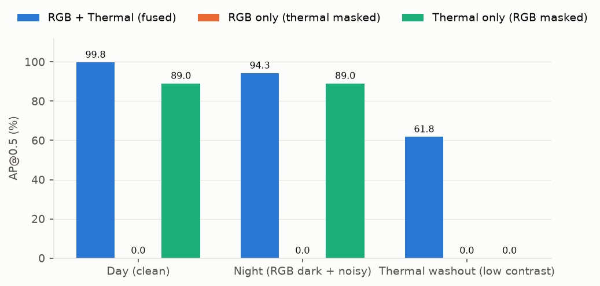
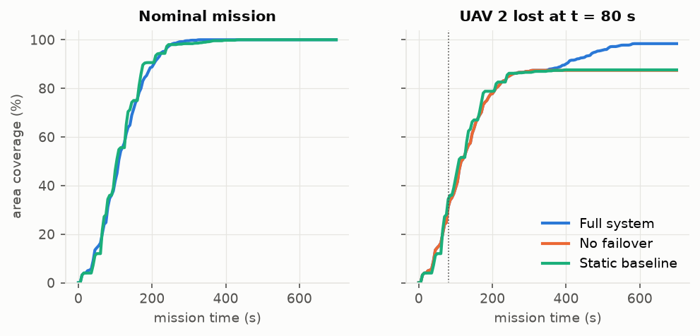
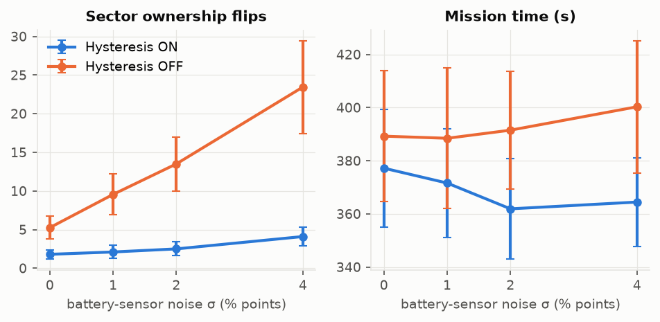
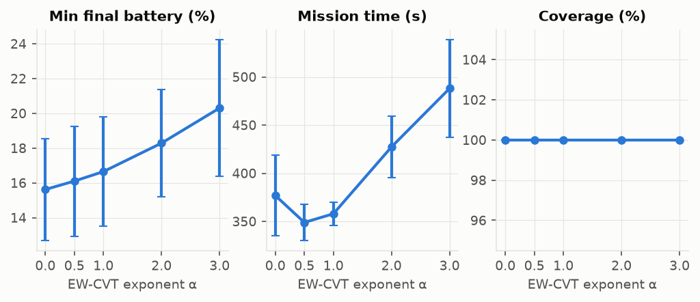
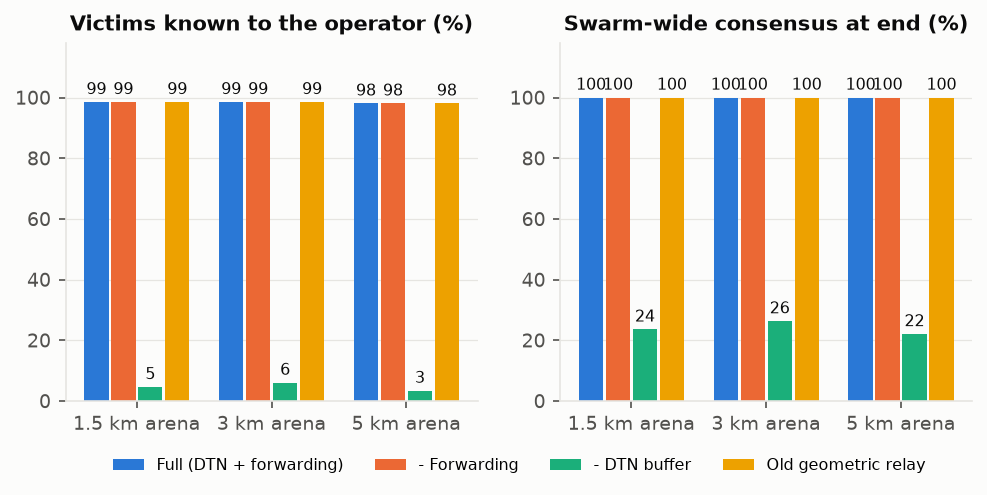
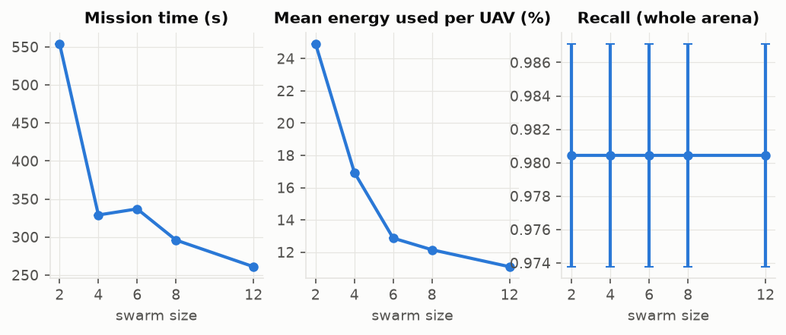

# Ablation Results

Autonomous multispectral UAV swarm for search and rescue (SAR). This document reports what each of the
three contributions buys, by switching it off and measuring what happens.

| # | Contribution | Where |
|---|---|---|
| 1 | 4-channel RGB + thermal early-fusion detector (YOLO11) | `rgbt_detector.py` |
| 2 | Delay-tolerant FANET mesh: RF physics, QoS-1 store-and-forward, store-carry-forward relaying | `FlySim/swarm_network.py` |
| 3 | Swarm control: Energy-Weighted CVT partitioning, dual-threshold hysteresis, autonomous failover | `FlySim/hysteresis_controller.py`, `simulate_swarm_mission.py` |

Everything here is **1320 simulated missions** plus a detector evaluation, and is reproducible
(see [Reproduce](#reproduce)). A self-contained HTML version with the same charts is in
[`final_report.html`](final_report.html).

## Headline: what each component buys

| Component removed → measured effect | Full system | Ablated | Change (paired mean ± 95% CI) |
|---|---:|---:|---:|
| **Failover** (UAV lost): area coverage | 98.4 % | 87.4 % | -11.0 ± 2.6 pts |
| &nbsp;&nbsp;victims found, whole arena (recall) | 0.962 | 0.840 | -0.122 ± 0.032 |
| **Hysteresis** (oracle planner, σ = 2 %): sector flips / mission | 2.5 | 13.5 | +11.0 ± 3.5 |
| &nbsp;&nbsp;route changes / mission | 4.8 | 25.4 | +20.6 ± 6.4 |
| &nbsp;&nbsp;mission time | 362 s | 392 s | +30 ± 25 s |
| **EW weighting** (α=0): min final battery | 18.8 % | 17.9 % | -0.8 ± 0.7 pts |
| Static baseline vs full: mission time (cost of re-planning) | 364 s | 353 s | -11 ± 29 s |
| **Decentralization** (UAV loss): mission time, oracle → per-UAV views | 421 s | 554 s | +133 ± 52 s |
| &nbsp;&nbsp;area coverage | 100.0 % | 98.4 % | -1.6 ± 2.9 pts |
| **DTN buffer** (5 km): victims known to operator | 98.0 % | 3.4 % | -94.7 ± 1.2 pts |
| &nbsp;&nbsp;swarm-wide consensus | 100.0 % | 22.1 % | -77.9 ± 1.3 pts |
| **Forwarding** (5 km): mean alert latency | 103 s | 109 s | +7 ± 2 s |
| &nbsp;&nbsp;UAV lost at 60 s: reports known to operator | 100.0 % | 100.0 % | +0.0 ± 0.0 pts |
| **Thermal channel** (masked), day: AP50 | 99.8 | 0.0 | -99.8 |
| &nbsp;&nbsp;night: AP50 | 94.3 | 0.0 | -94.3 |

*Change* is the paired difference over 20 seeds with a 95 % confidence interval; if the interval
contains zero the effect is not established. Hysteresis rows come from the oracle planner at σ = 2 %: in the decentralized planner
sectors are claimed once and rarely re-assigned, so there is almost no churn for hysteresis to remove (see §2). Removing hysteresis does not change mission time
beyond noise.

## How the experiments are set up

- **Mission.** 6 UAVs search a 5 km × 5 km arena divided into 25 sectors. Each sector shows one real frame
  from the NII-CU RGB-thermal drone dataset, with its human labels as ground truth. UAVs launch from a base
  station, fly to sector centres, run the detector there, and return home.
- **Seeds and pairing.** A seed fixes which frame sits in which sector and each UAV's launch battery
  (uniform 20–100 %). Every variant runs on the same 20 seeds, so differences come from the removed
  component rather than the draw. Tables show mean ± standard deviation across seeds.
- **UAV loss scenario.** UAV 2 suffers a motor failure at t = 80 s and goes silent. The other UAVs are not told.
- **Energy rule.** A UAV at 15 % battery or below aborts and returns to base; at 0 % it is lost.
- **Decentralized control loop** (every 5 s, **per UAV, from its own view only**): each UAV reads its own battery
  (with sensor noise σ = 1.5 % points by default), computes its weight `w = (B / 100)^α`, and the EW-CVT centroid its cell
  *should* have given the peers it believes are active (their last *advertised* generators and weights). The hysteresis
  controller commits the change only if the battery has dropped by at least 2 % **and** the centroid has moved at
  least 5 m, or its view of the live UAVs changed (forced override). The UAV then claims the unscanned sectors it is the
  preferred owner of by power distance `‖c_s − g_i‖² / w_i`, using committed values. There is no central planner:
  views are exchanged by beacons over the lossy radio (every 5 s), and conflicts are resolved by the same power-distance
  rule when two UAVs meet. See [§5](#5-decentralized-vs-oracle-planning). The earlier *oracle* planner, which computes
  all assignments from the true state of every UAV and assumes a failure is noticed instantly, is kept as a baseline
  (`--planner centralized`).
- **Operator view.** Every victim alert is sent to all peers and to a ground control station (GCS) at the
  base. *Operator recall* is the share of all victims in the arena that the GCS actually learned about.

## 1. Perception: does the thermal channel matter?

| Condition | Input | AP50 | AP75 | Precision | Recall | F1 |
|---|---:|---:|---:|---:|---:|---:|
| Day (clean) | RGB + Thermal (fused) | 99.82 | 85.76 | 0.993 | 0.989 | 0.991 |
| Day (clean) | RGB only (thermal masked) | 0.0 | 0.0 | 0.000 | 0.000 | 0.000 |
| Day (clean) | Thermal only (RGB masked) | 89.03 | 50.52 | 0.944 | 0.731 | 0.824 |
| Night (RGB dark + noisy) | RGB + Thermal (fused) | 94.31 | 58.26 | 0.916 | 0.869 | 0.892 |
| Night (RGB dark + noisy) | RGB only (thermal masked) | 0.0 | 0.0 | 0.000 | 0.000 | 0.000 |
| Night (RGB dark + noisy) | Thermal only (RGB masked) | 89.03 | 50.52 | 0.944 | 0.731 | 0.824 |
| Thermal washout | RGB + Thermal (fused) | 61.82 | 25.07 | 0.991 | 0.386 | 0.555 |
| Thermal washout | RGB only (thermal masked) | 0.0 | 0.0 | 0.000 | 0.000 | 0.000 |
| Thermal washout | Thermal only (RGB masked) | 0.0 | 0.0 | 0.000 | 0.000 | 0.000 |



150 held-out NII-CU val frames (fixed random subset), IoU 0.5 matching, operating point conf ≥ 0.25.
*Night* darkens RGB to 12 % brightness and adds noise; *thermal washout* squashes thermal contrast to 25 %.

- Fusion beats thermal-only by about 11 AP points in daylight, so RGB adds real information.
- Losing RGB light (night) costs the fused model only 5.5 AP points, because thermal carries it.
- Thermal washout hurts most: recall falls to 0.39 while precision stays at 0.99.

> **Important caveat.** This is *modality-masked inference* of one fused network (a channel is set to zero),
> **not** three separately trained networks. The 0.0 for RGB-only means the network was never trained to work
> without thermal; it does not mean RGB is uninformative. Properly trained RGB-only / thermal-only baselines
> are set up in the notebook `nii_cu_ablation_2gpu.ipynb` but have not been run. Train and val come from the
> same site, so absolute numbers are optimistic.

## 2. Swarm control: EW-CVT, hysteresis, failover

Variants (decentralized planner): **Full** (EW-CVT α = 1, hysteresis, failover, 5 s replans); **− EW weighting** (α = 0, plain Voronoi);
**− Hysteresis** (every replan commits); **− Failover** (a lost UAV's sectors stay lost); **Static baseline**
(partition once at launch, never change).

| Scenario | Variant | Coverage % | Recall (arena) | Mission time s | Min final battery % | Sector flips | Route changes | Low-batt. aborts |
|---|---:|---:|---:|---:|---:|---:|---:|---:|
| Nominal | Full system | 100.0 ± 0.0 | 0.980 ± 0.015 | 353 ± 31 | 18.8 ± 8.3 | 0.2 ± 0.7 | 0.9 ± 2.5 | 0.55 ± 0.60 |
| Nominal | - EW weighting (alpha=0) | 100.0 ± 0.0 | 0.980 ± 0.015 | 365 ± 59 | 17.9 ± 7.9 | 0.3 ± 0.8 | 1.4 ± 3.3 | 0.50 ± 0.61 |
| Nominal | - Hysteresis | 100.0 ± 0.0 | 0.980 ± 0.015 | 353 ± 31 | 18.8 ± 8.3 | 0.4 ± 0.9 | 1.6 ± 3.0 | 0.55 ± 0.60 |
| Nominal | Static baseline | 100.0 ± 0.0 | 0.980 ± 0.015 | 364 ± 59 | 17.9 ± 7.9 | 0.1 ± 0.5 | 1.2 ± 3.0 | 0.50 ± 0.61 |
| UAV loss | Full system | 98.4 ± 6.3 | 0.962 ± 0.069 | 554 ± 97 | 19.7 ± 10.4 | 7.5 ± 4.9 | 9.0 ± 3.9 | 0.65 ± 0.75 |
| UAV loss | - EW weighting (alpha=0) | 99.6 ± 1.8 | 0.978 ± 0.020 | 586 ± 62 | 19.7 ± 10.1 | 7.8 ± 4.4 | 8.8 ± 4.5 | 0.60 ± 0.82 |
| UAV loss | - Hysteresis | 98.6 ± 6.3 | 0.964 ± 0.070 | 534 ± 98 | 19.1 ± 10.4 | 6.8 ± 5.1 | 10.1 ± 4.6 | 0.70 ± 0.73 |
| UAV loss | - Failover | 87.4 ± 6.5 | 0.840 ± 0.076 | 346 ± 35 | 21.3 ± 11.2 | 0.1 ± 0.2 | 0.3 ± 0.9 | 0.50 ± 0.61 |
| UAV loss | Static baseline | 87.6 ± 1.8 | 0.858 ± 0.051 | 353 ± 62 | 20.3 ± 10.9 | 0.1 ± 0.2 | 0.8 ± 2.4 | 0.50 ± 0.69 |

*Sector flips* = sectors a UAV gave up because a better claim beat it (failover excluded). *Route changes* = times a
UAV had to re-plan its route. High values mean the swarm is chattering. In the decentralized planner claims are sticky, so flips and route changes are low for every variant and the
hysteresis and re-planning ablations show little here: that is a result about the planner, not evidence that hysteresis is useless. *Recall (arena)* counts victims over the whole arena, so
sectors that are never searched count against the system.

### Resilience: coverage over time



With no failure every variant reaches full coverage around 350–370 s. After the UAV loss, variants with failover recover most of the lost
area (98.4 % final coverage) but only after the failure has been noticed, which takes minutes (§5); without failover the lost UAV's sectors are never
searched (87.4 % coverage).

### Hysteresis suppresses chattering under sensor noise (oracle planner)



| Sensor noise σ (%) | Flips: hyst. ON | Flips: hyst. OFF | Commits ON | Commits OFF | Time ON (s) | Time OFF (s) |
|---|---:|---:|---:|---:|---:|---:|
| 0 | 1.8 ± 1.3 | 5.2 ± 3.4 | 32 ± 5 | 294 ± 24 | 377 ± 49 | 389 ± 55 |
| 1 | 2.1 ± 1.9 | 9.6 ± 5.9 | 31 ± 4 | 295 ± 28 | 372 ± 46 | 388 ± 59 |
| 2 | 2.5 ± 2.0 | 13.5 ± 7.8 | 31 ± 4 | 296 ± 24 | 362 ± 42 | 392 ± 49 |
| 4 | 4.1 ± 2.6 | 23.4 ± 13.4 | 30 ± 5 | 300 ± 30 | 364 ± 37 | 400 ± 56 |

Hysteresis only matters when partitions are recomputed from noisy readings every tick, so this experiment uses the oracle planner. Without hysteresis every replan commits, so battery-sensor noise keeps moving sector borders. Commits are about
10× fewer with hysteresis, and the gap in sector flips widens as noise grows.

### EW-CVT exponent α: time versus energy reserve



| α | Min final battery % | Mission time s | Coverage % | Low-battery aborts |
|---|---:|---:|---:|---:|
| 0 | 15.6 ± 6.5 | 377 ± 94 | 100.0 ± 0.0 | 0.95 ± 0.89 |
| 0.5 | 16.1 ± 7.1 | 349 ± 42 | 100.0 ± 0.0 | 0.90 ± 0.85 |
| 1 | 16.7 ± 7.0 | 358 ± 27 | 100.0 ± 0.0 | 0.90 ± 0.85 |
| 2 | 18.3 ± 6.9 | 427 ± 71 | 100.0 ± 0.0 | 0.45 ± 0.76 |
| 3 | 20.3 ± 8.8 | 488 ± 114 | 100.0 ± 0.0 | 0.30 ± 0.47 |

Larger α shrinks weak UAVs' territory, which raises the minimum remaining battery and reduces low-battery aborts but lengthens the mission, because
healthy UAVs carry more of the work. α is a dial between speed and energy safety; it is not a free improvement.
Coverage is 100 % at every α, so the third panel is flat.

## 3. Networking: delay-tolerant mesh and store-carry-forward relaying

| Arena | Variant | Operator recall | Alert latency s | Consensus | First-attempt PDR to GCS | Messages lost | Delivered late (DTN) |
|---|---:|---:|---:|---:|---:|---:|---:|
| 1.5 km | Full (DTN + forwarding) | 0.985 ± 0.013 | 34 ± 4 | 1.000 ± 0.000 | 0.045 ± 0.026 | 0 ± 0 | 251 ± 30 |
| 1.5 km | - Forwarding | 0.985 ± 0.013 | 41 ± 5 | 1.000 ± 0.000 | 0.043 ± 0.031 | 0 ± 0 | 251 ± 29 |
| 1.5 km | - DTN buffer | 0.046 ± 0.028 | 0 ± 0 | 0.236 ± 0.025 | 0.047 ± 0.029 | 252 ± 30 | 0 ± 0 |
| 1.5 km | Old geometric relay | 0.985 ± 0.013 | 41 ± 5 | 1.000 ± 0.000 | 0.064 ± 0.036 | 0 ± 0 | 250 ± 29 |
| 3 km | Full (DTN + forwarding) | 0.985 ± 0.013 | 41 ± 4 | 1.000 ± 0.000 | 0.061 ± 0.046 | 0 ± 0 | 243 ± 28 |
| 3 km | - Forwarding | 0.985 ± 0.013 | 59 ± 7 | 1.000 ± 0.000 | 0.059 ± 0.045 | 0 ± 0 | 243 ± 28 |
| 3 km | - DTN buffer | 0.060 ± 0.033 | 0 ± 0 | 0.263 ± 0.027 | 0.062 ± 0.036 | 244 ± 28 | 0 ± 0 |
| 3 km | Old geometric relay | 0.985 ± 0.013 | 59 ± 6 | 1.000 ± 0.000 | 0.084 ± 0.036 | 0 ± 0 | 240 ± 29 |
| 5 km | Full (DTN + forwarding) | 0.980 ± 0.015 | 103 ± 13 | 1.000 ± 0.000 | 0.033 ± 0.024 | 0 ± 0 | 258 ± 30 |
| 5 km | - Forwarding | 0.980 ± 0.015 | 109 ± 12 | 1.000 ± 0.000 | 0.037 ± 0.026 | 0 ± 0 | 257 ± 29 |
| 5 km | - DTN buffer | 0.034 ± 0.019 | 0 ± 0 | 0.221 ± 0.027 | 0.036 ± 0.022 | 257 ± 30 | 0 ± 0 |
| 5 km | Old geometric relay | 0.980 ± 0.015 | 110 ± 12 | 1.000 ± 0.000 | 0.050 ± 0.031 | 0 ± 0 | 256 ± 30 |



Under the RF model (log-distance path loss, exponent 2.5, 4 dB shadowing) direct links reach only a few hundred metres, so
the swarm is mostly disconnected in flight and first-attempt delivery to the GCS is low everywhere. Store-and-forward queues
alerts in the UAV's buffer and flushes them when it returns to base, which turns a mostly-offline swarm into one the operator can
rely on.

**Store-carry-forward.** A UAV that receives an alert keeps a copy for every recipient not known to hold it, and hands it over whenever it later meets that recipient with a good link (the same rule as the base flush). No UAV has to sit between two others at the right moment, so this replaces the old instant geometric relay (last variant above), which adds nothing in a sparse swarm. On contact, only copies the other side lacks are sent; the simulator reads the recipient's holdings as the exchanged summary.

### A UAV is lost before it returns

| Arena | Variant | Reports known to operator | Alert latency s | Consensus | Copies forwarded |
|---|---:|---:|---:|---:|---:|
| 1.5 km | Full (DTN + forwarding) | 0.989 ± 0.020 | 46 ± 6 | 0.989 ± 0.020 | 98 ± 14 |
| 1.5 km | - Forwarding | 0.976 ± 0.025 | 55 ± 7 | 0.978 ± 0.024 | 0 ± 0 |
| 3 km | Full (DTN + forwarding) | 0.993 ± 0.014 | 46 ± 7 | 0.993 ± 0.014 | 109 ± 10 |
| 3 km | - Forwarding | 0.973 ± 0.026 | 66 ± 9 | 0.978 ± 0.021 | 0 ± 0 |
| 5 km | Full (DTN + forwarding) | 1.000 ± 0.000 | 101 ± 10 | 1.000 ± 0.000 | 108 ± 10 |
| 5 km | - Forwarding | 1.000 ± 0.000 | 110 ± 12 | 1.000 ± 0.000 | 0 ± 0 |

If the finder is lost, its alerts reach the operator only if a peer that received them returns to base. Forwarding is what makes that possible.

### Buffer cap per UAV (3 km, UAV lost)

| Cap (copies per UAV) | Reports known to operator | Alert latency s | Copies dropped |
|---|---:|---:|---:|
| 5 | 0.225 ± 0.043 | 26 ± 14 | 389 ± 47 |
| 15 | 0.415 ± 0.077 | 31 ± 7 | 374 ± 47 |
| 40 | 0.834 ± 0.092 | 45 ± 7 | 253 ± 53 |
| 120 | 0.993 ± 0.014 | 46 ± 7 | 11 ± 30 |
| unlimited | 0.993 ± 0.014 | 46 ± 7 | 0 ± 0 |

Epidemic forwarding stores many copies. Capping the buffer drops the oldest first; the table shows how small it can be before operator coverage suffers.

## 4. Scaling with swarm size



| Swarm size | Mission time s | Mean energy used / UAV % | Recall (arena) |
|---|---:|---:|---:|
| 2 | 554 ± 0 | 24.9 ± 0.0 | 0.980 ± 0.015 |
| 4 | 329 ± 0 | 16.9 ± 0.0 | 0.980 ± 0.015 |
| 6 | 337 ± 0 | 12.9 ± 0.0 | 0.980 ± 0.015 |
| 8 | 296 ± 0 | 12.2 ± 0.0 | 0.980 ± 0.015 |
| 12 | 261 ± 0 | 11.1 ± 0.0 | 0.980 ± 0.015 |

Time falls and per-UAV energy falls as the swarm grows; the speedup is sublinear because transit from the base is a fixed cost.
The small non-monotonicity between 4 and 6 UAVs is probably an artefact of how starting territories are laid out (corners for ≤ 4, a ring for more); this has not been verified.

## 5. Decentralized vs oracle planning

The default planner has no central overseer. Each UAV keeps its own view (peers' last advertised position, committed generator and weight,
claimed sectors with planned arrival times, and the sectors it knows to be scanned) and exchanges it with peers by beacon. Because a beacon is
an ordinary radio packet, most are lost while the swarm is spread out, and views go stale. The design handles that as follows:

- **Failure detection by overdue return, not by silence.** Silence is normal in flight. A peer advertises when its route should bring it home; if it is
  still missing *lease slack* seconds after that, it is suspected lost and its claims are released. A UAV cannot tell a lost peer from one that landed
  and went quiet, so released work is only taken by a UAV that is **at base** (where it hears landed peers and relaunches, sharing the work by power distance).
- **Claims, not assignments.** A UAV takes sectors it is the preferred owner of by power distance and that nobody validly claims; it yields to a better claim when it hears one,
  and an idle UAV picks up nearby unclaimed work.
- **Launch.** UAVs start co-located on the pad, so they begin with the same view and the same EW-CVT launch partition.

| Scenario | Planner | Coverage % | Recall (arena) | Mission time s | Duplicate scans | Failover latency s | Sector flips | Min final battery % |
|---|---:|---:|---:|---:|---:|---:|---:|---:|
| 5 km, no failure | Oracle | 100.0 ± 0.0 | 0.980 ± 0.015 | 367 ± 47 | 0.0 ± 0.0 | n/a (instant) | 2.1 ± 1.8 | 18.9 ± 8.5 |
| 5 km, no failure | Per-UAV views | 100.0 ± 0.0 | 0.980 ± 0.015 | 353 ± 31 | 0.0 ± 0.0 | n/a | 0.2 ± 0.7 | 18.8 ± 8.3 |
| 5 km, UAV 2 lost | Oracle | 100.0 ± 0.0 | 0.980 ± 0.015 | 421 ± 67 | 0.0 ± 0.0 | n/a (instant) | 3.4 ± 2.6 | 20.7 ± 11.5 |
| 5 km, UAV 2 lost | Per-UAV views | 98.4 ± 6.3 | 0.962 ± 0.069 | 554 ± 97 | 1.4 ± 1.5 | 231 ± 43 | 7.5 ± 4.9 | 19.7 ± 10.4 |
| 3 km, UAV 2 lost | Oracle | 100.0 ± 0.0 | 0.985 ± 0.013 | 236 ± 36 | 0.0 ± 0.0 | n/a (instant) | 1.6 ± 1.6 | 25.2 ± 11.6 |
| 3 km, UAV 2 lost | Per-UAV views | 99.0 ± 4.5 | 0.974 ± 0.047 | 326 ± 61 | 1.4 ± 0.9 | 143 ± 23 | 5.8 ± 4.9 | 24.9 ± 11.5 |
| 1.5 km, UAV 2 lost | Oracle | 100.0 ± 0.0 | 0.985 ± 0.013 | 146 ± 15 | 0.0 ± 0.0 | n/a (instant) | 1.6 ± 1.2 | 28.2 ± 10.7 |
| 1.5 km, UAV 2 lost | Per-UAV views | 99.2 ± 2.8 | 0.973 ± 0.035 | 171 ± 61 | 0.8 ± 1.5 | 102 ± 5 | 0.8 ± 1.7 | 28.3 ± 10.7 |

- **No failure:** the decentralized planner matches the oracle (it finishes slightly sooner, as it does not re-plan in flight).
- **UAV lost:** the price of not knowing is time. The swarm cannot know UAV 2 is gone until it is overdue back at base, so failover latency is minutes and mission time is
  longer than the oracle's, with a little duplicate scanning. In a few seeds sectors stay unsearched because the survivors have no battery left for a second sortie by the time they learn of the loss (for example when the lost UAV was the one with the most charge; the oracle avoids this by re-planning at once, before the survivors spend their reserves). The gap narrows in small arenas where UAVs meet more often.
- **Wrong suspicions are common** (most suspicions are of UAVs that were fine): a UAV that returned and landed looks the same as one that crashed to anyone still in flight. They cost little because released work is
  taken only at base.

### Failure-detection lease slack

| Lease slack s | Failover latency s | Mission time s | Coverage % | Duplicate scans | False suspicions of all |
|---|---:|---:|---:|---:|---:|
| 20 | 192 ± 43 | 518 ± 101 | 98.6 ± 6.3 | 1.1 ± 1.2 | 11.2 of 15.6 |
| 60 | 231 ± 43 | 554 ± 97 | 98.4 ± 6.3 | 1.4 ± 1.5 | 8.3 of 12.6 |
| 120 | 293 ± 42 | 587 ± 102 | 98.6 ± 6.3 | 0.7 ± 0.6 | 3.6 of 8.0 |
| 240 | 411 ± 43 | 698 ± 128 | 98.6 ± 6.3 | 0.7 ± 0.5 | 0.4 of 4.7 |

Slack trades detection speed for false alarms: short slack finds the dead UAV sooner but raises false suspicions; long slack is nearly free of false alarms but delays failover by minutes.

### Beacon interval

| Beacon interval s | Mission time s | Coverage % | Duplicate scans | Control messages delivered |
|---|---:|---:|---:|---:|
| 2 | 532 ± 95 | 98.6 ± 6.3 | 0.6 ± 0.5 | 1845 ± 776 |
| 5 | 554 ± 97 | 98.4 ± 6.3 | 1.4 ± 1.5 | 796 ± 330 |
| 15 | 587 ± 107 | 98.4 ± 6.3 | 2.4 ± 2.6 | 268 ± 105 |
| 60 | 629 ± 185 | 96.4 ± 8.3 | 2.6 ± 2.4 | 78 ± 24 |

Beacons are only exchanged on the rare contacts, so interval hardly matters until it becomes comparable to the contact duration (60 s), at which point views go stale and duplicate scanning rises.

## What these results do and do not show

- **Simulation, not flight.** Dynamics are kinematic (constant speed, linear battery drain). The EW-CVT, hysteresis, failover, claiming and DTN logic is real code under test; the aircraft and radio are models.
- **Decentralization simplifications.** Beacons are single-hop (no relaying of third-party state), the GCS only receives alerts and does no planning, UAVs share the initial partition because they launch together, and victim alerts are still addressed to every peer whether or not it is alive (copies for a dead UAV just sit in buffers). Forwarding reads the receiver's holdings as the summary exchanged at contact instead of simulating that exchange.
  The failure detector and the relaunch policy are one design, not the only one.
- **Detection inside missions replays static frames.** Each sector shows one image, so mission-level precision and recall mostly reflect the detector on those frames plus sector coverage.
- **Network results depend on the RF model** (33 dBm at 2.4 GHz for arenas ≥ 2 km, 30 dBm at 5 GHz below). Real links would differ.
- **Assumptions.** The 15 % abort rule and the 0–4 % battery-sensor-noise levels are scenario assumptions (noise is swept above).
- **Static baseline.** In the nominal case the static baseline takes +11 s relative to the full system (100.0 % coverage).
- **Earlier numbers superseded.** An earlier version of the simulator let UAVs teleport to their first waypoint and then drift back toward the launch pad, which invalidated mission time,
  time-to-first-detection, energy and hysteresis statistics (the benchmark table in the top-level `README.md` came from that version). That is fixed; detection precision, recall and localization were unaffected. The numbers in this document replace them.

## Reproduce

```bash
source FlySim/venv/bin/activate

python ablation/perception_eval.py --n 150          # ~20 min on CPU  -> results/ablation/perception.json
python ablation/run_ablation.py --seeds 20            # ~1 min after detector cache is warm -> results/ablation/runs.json
python ablation/make_report.py                       # -> results/final_report.html + results/figures/*.png
python ablation/make_readme.py                       # -> this file
```

Each switch can also be used from the single-mission CLI, for example:

```bash
python simulate_swarm_mission.py --drones 6 --arena 5000 --duration 900 \
    --batt-min 20 --batt-noise 1.5 --fail-drone 2 --fail-time 80 \
    --no-hysteresis --out-dir /tmp/run1          # also: --no-failover --static --no-dtn --no-forwarding --alpha 0
```

The ablation harness never writes outside `results/`, so it will not overwrite mission outputs in the repository root.

## Files

| Path | Contents |
|---|---|
| `ablation/perception_eval.py` | Modality-masked detector evaluation |
| `ablation/run_ablation.py` | Swarm ablation harness (configurations, seeds, parallel runs) |
| `ablation/make_report.py` | HTML report and chart export |
| `ablation/make_readme.py` | Generates this file from the run data |
| `results/ablation/runs.json` | Raw per-mission metrics and coverage time series |
| `results/ablation/perception.json` | Raw detector metrics |
| `results/final_report.html` | Self-contained HTML report |
| `results/figures/` | Charts used above |
